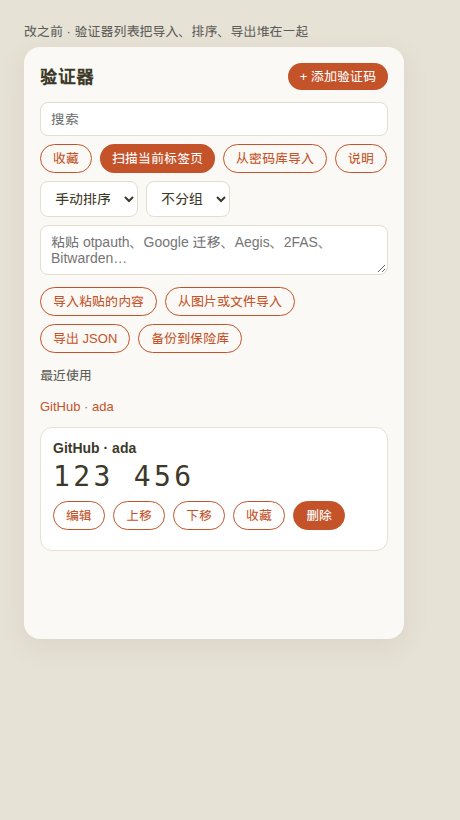
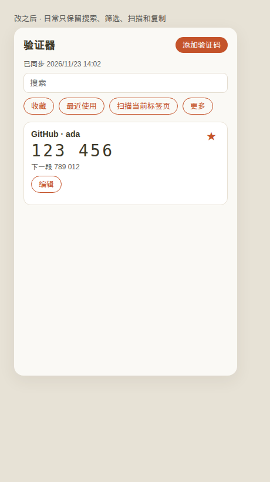
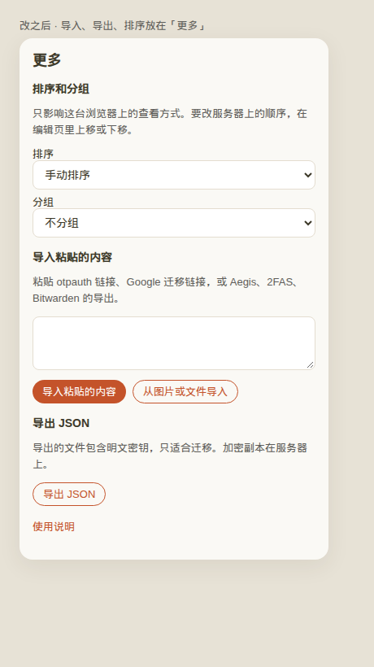
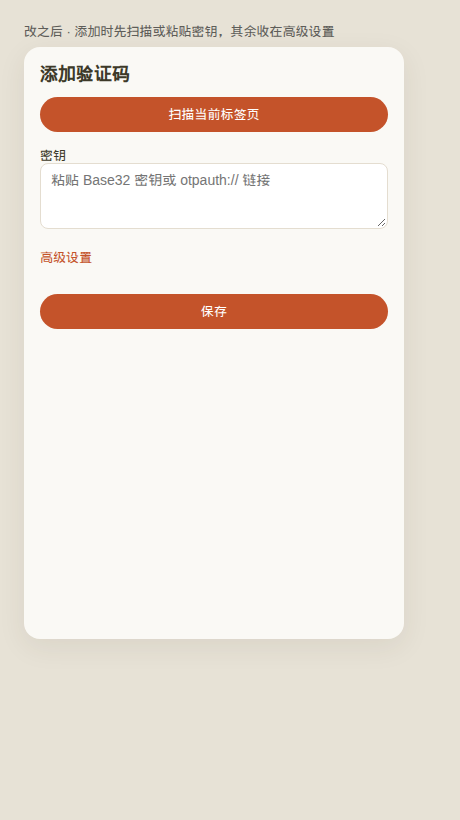
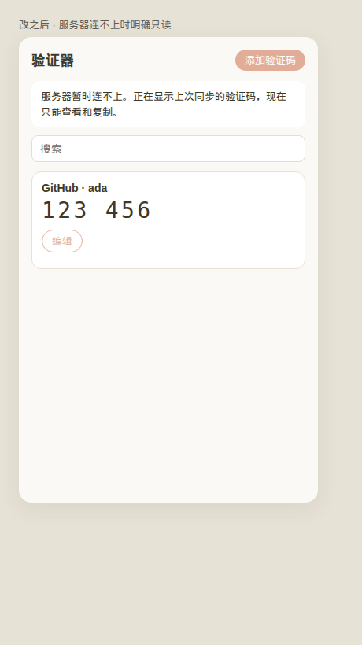
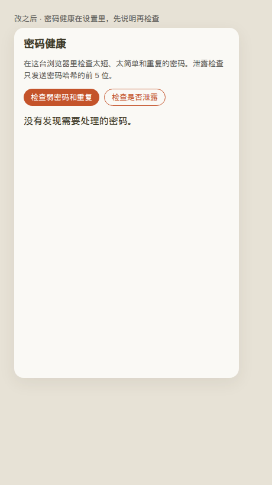

# 产品审查：Bitwarden 验证器版

审查对象是浏览器扩展「Bitwarden 验证器版」和它依赖的自建 Vaultwarden。对照的是日常会拿来换用的密码管理器和验证器：1Password、官方 Bitwarden、Google Authenticator、Microsoft Authenticator、Authy、2FAS、Aegis、Ente Auth。

结论先说：验证码、搜索、收藏、屏幕扫码、服务器同步这些日常能力已经在。缺的是「验证码能跟着网站走」和「从别的验证器搬过来」。这次把这两件事补上，并把不常用的导入、导出、排序从验证码列表里拿开。

## 对标

| 能力 | 1Password | 官方 Bitwarden | Google / Microsoft | Authy | 2FAS / Aegis / Ente | 本扩展（改之前） | 这次 |
| --- | --- | --- | --- | --- | --- | --- | --- |
| 验证码跟登录在一起，填充时带上 | 有 | 有，登录项自己的 TOTP，且常要高级版 | 没有密码库 | 没有 | 2FAS 浏览器扩展可以填 | 验证器页和登录项是两套数据，登录项 TOTP 还看高级版 | 本服务器上的码不再卡高级版；登录项没有码时，按网站主机用验证器页的码 |
| 扫二维码、粘贴 otpauth | 有 | 有 | 有 | 有 | 有 | 有，当前标签页和单条链接 | 保留，并认 Google 迁移二维码 |
| 从 Google / Aegis / 2FAS / Bitwarden 批量导入 | 有 | 有 | Google 自己的迁移码 | Authy 已不好导出 | 各自的 JSON | 只能从密码库登录项一笔笔导入 | 未加密的那些格式可以一次导入 |
| 导出、加密备份 | 有 | 保险库导出 | 弱 | 账号绑定 | Aegis 可加密导出 | 没有验证器导出 | JSON 明文迁移文件；加密备份写成保险库安全笔记 |
| 搜索、收藏、分组 | 有 | 有 | 搜索弱，无分组 | 有 | 有 | 搜索、收藏、手动排序 | 排序和分组放到「更多」，标签存在条目里 |
| 倒计时、点按复制、下一段 | 有 | 有 | 有 | 有 | 有 | 倒计时和复制有 | 加上下一段预览 |
| Steam、HOTP、8 位、60 秒、SHA256/512 | 部分 | TOTP 参数有 | 基本只有 6 位 30 秒 | 有限 | Aegis / 2FAS 较全 | 算法、位数、周期已有；Steam 只是把位数改成 5 | Steam 用 Steam 字符表；HOTP 记计数器 |
| 当前网站一键复制 | 有 | 快捷键主要是填充登录 | 没有 | 没有 | 2FAS 有 | 没有 | 增加命令，不占用官方那组快捷键 |
| 弱密码、重复、泄露 | 有 | 有，高级版报告 | 没有 | 没有 | 没有 | 扩展里有高级版健康报告 | 设置里增加不看高级版的本地检查，泄露只发哈希前 5 位 |
| 离线只读、同步时间 | 有 | 有本地保险库 | 账号在线 | 在线 | 本地库 | 缓存锁上就丢，失败时不像只读 | 密文留在本机，连不上就只读并写明 |
| 剪贴板过一会清空 | 有 | 有设置 | 没有 | 没有 | 部分有 | 设置有，验证器复制没用上 | 验证器复制走原来的清空时间 |
| 生物识别 / PIN | 有 | 有，生物识别靠桌面端 | 有 | 有 | 有 | PIN 在账户安全里；本扩展不连官方桌面 | 不新做生物识别 |
| 回收站 | 有 | 登录项有 | 没有 | 没有 | 部分有 | 登录项回收站已有；验证码是直接删除 | 验证码删除改到编辑页，并要再点一次确认 |
| 打开就教学、推销 | 各家都有 | 有 | 有 | 有 | 较少 | 已经拿掉 | 不加回来 |

## 缺口和决定

| 缺口 | 对使用者的价值 | 优先级 | 工作量 | 决定 |
| --- | --- | --- | --- | --- |
| 验证码填进网页上的验证码框，填完密码后复制 | 两步登录不用再打开验证器页对着抄 | P0 | 中。走现有自动填充，不新做一套填表 | 做。登录项自己有码就用它；没有就按主机找验证器条目 |
| 从 Google 迁移码、Aegis、2FAS、Bitwarden 一次导入 | 换到这套扩展的第一天就能用 | P0 | 中。都是明文格式，解析在本地 | 做。加密的 Aegis、Authy 不做 |
| 导出和加密备份 | 密钥不能只活在一个扩展里 | P0 | 小。加密沿用保险库安全笔记，不新写加密 | 做 |
| 点一下复制、倒计时、下一段 | 抄码时知道这一段还剩几秒，下一段是什么 | P0 | 小 | 做。列表上点卡片就复制 |
| 连不上服务器时仍能看码，并说清楚不能改 | 服务器抖动时不会以为码丢了 | P0 | 小。密文改存磁盘，解锁后还能解密 | 做 |
| 复制后按原来的设置清空剪贴板 | 验证码不留在剪贴板里 | P1 | 小 | 做 |
| 当前网站的快捷键 | 手不离开键盘 | P1 | 小 | 做。命令不设默认按键，避免占 Ctrl+Shift+L / Y / U / 9 |
| 网站主机、分组标签 | 同一个发行方有多个号时能对上网站 | P1 | 小。写在已有的备注密文里，服务器不用改表 | 做 |
| 排序、分组、最近使用 | 码多了之后找得到 | P1 | 小。查看方式留在这台浏览器 | 做，放在「更多」，不放在每天看的列表上 |
| Steam、HOTP | 少数账号需要 | P1 | 小 | 做。HOTP 的计数器跟条目一起存 |
| 密码健康（弱、重复、泄露） | 自建服务器没有官方高级版报告 | P1 | 中 | 做成本地检查。泄露查询用 k-匿名，只送 SHA-1 前 5 位 |
| 生成器三个预设 | 常用的 20 位、6 位数字、口令不用每次重设 | P1 | 小 | 做。点一下生成并复制 |
| 使用说明 | 不靠欢迎页也能知道扫码、填充、导入在哪 | P1 | 小 | 做一页说明，从设置和「更多」进去 |
| Authy、加密 Aegis | 有人还存着旧备份 | P2 | 大，而且是另一套口令解密 | 不做。请在原应用里导出未加密 JSON |
| 验证码回收站 | 误删能找回 | P2 | 要改 Vaultwarden，另一路正在改 MCP | 不做。删除放到编辑页，并要再确认一次。登录项回收站本来就有 |
| 生物识别解锁 | 少输入主密码 | P2 | 依赖官方桌面通道，这个扩展故意不占那条通道 | 不做。PIN 仍在账户安全里 |
| 别名和 MCP 读取 | 给别的程序取验证码 | — | 另一路在做 | 不碰 |
| 登录时询问保存密码 | 少漏存 | — | 另一路在做 1.0.6 | 不碰 |

服务器表结构没有改。主机、标签、HOTP 计数器和类型写在条目已有的加密备注末尾，所以仍然只存在你的 Vaultwarden 上。

## 信息架构

每天打开弹出窗口，要做的事只有三件：找到码、复制、偶尔扫一个新的。

- 验证器列表：搜索、收藏、最近使用、扫描当前标签页、添加。点卡片复制。一颗星收藏。编辑进单独一页。
- 「更多」：排序、分组、粘贴或文件导入、从密码库导入、导出、备份到保险库、使用说明。
- 添加页：扫描和密钥在上面。名称、算法、位数、周期、网站主机、分组、Steam、HOTP 都在「高级设置」里。编辑页才把名称和发行方放出来，因为那时你是在改这一条；删除和上下移动也在编辑页底部，删除要再点一次。
- 密码健康、使用说明在设置里。生成器预设在生成器顶部，一行三个。
- 不增加欢迎卡、轮播或升级提示。

## 走查

按 Nielsen 的十条看了一遍，并按真实顺序走了这些事：第一次打开并登录、日常自动填充、扫二维码加验证码、复制、从 Google 验证器导入、看密码健康、服务器连不上。

走查用的是弹出窗口的实际版面，在 Chrome 里截下来。还没有在这台机器上把扩展和生产 Vaultwarden 一起跑起来，所以下面不是对真实网页的端到端录像。版面和文案跟代码里的页面一致。

### 发现和改法

| 启发式 | 走查里看到的问题 | 改法 |
| --- | --- | --- |
| 系统状态看得见 | 同步是否成功、是不是旧数据，列表上没有一句话 | 正常时写「已同步」和时间。连不上时用一句话说明正在用上次的码，而且只能看和复制 |
| 贴近使用者的语言 | 按钮堆在一起之后，「导入」既像从密码库导入，又像贴链接 | 列表上的入口改叫「更多」。密码库导入、粘贴导入、文件导入分成三段，各有一句说明 |
| 使用者能控制 | 每条码下面都有删除，容易在要复制时点到 | 列表不再放删除和上下移动。删除在编辑页，按钮会变成「确认删除」 |
| 一致 | 同一屏里主按钮和次按钮抢注意力，扫描被做成和添加一样醒目 | 列表上只有「添加验证码」是实心主按钮。扫描、收藏、最近、更多用线框 |
| 防错 | 加密的 Aegis 文件若静默失败，人会以为导入坏了 | 认出来是加密备份时，直接说请回原应用导出未加密 JSON。导出文件旁边写明里面是明文 |
| 认得出，而不是靠记 | 五个文字按钮没有主次，星号只是标题前缀 | 收藏是单独的星形按钮，带读屏名称。复制是整张卡片 |
| 兼顾熟手 | 快捷键若占用官方扩展的组合，两个扩展会打架 | 新命令不设默认按键。说明里写可以自己绑，例如 Alt+Shift+T |
| 克制 | 搜索下面同时有排序、分组、粘贴框、四个导入导出按钮，码被挤到下面 | 这些全部进「更多」。列表先看到码 |
| 出错能恢复 | 保存失败已有提示，但离线时按钮仍像能改 | 离线时添加、扫描、编辑、导入、备份都不可用。复制还可以 |
| 帮助在需要时出现 | 若把说明做成第一屏卡片，又回到已经拿掉的引导 | 说明是一页普通页面，从设置和「更多」进入，不在登录后自动出现 |

### 各条路径

1. 第一次安装和登录。登录页仍然只有服务器地址和邮箱，然后是主密码。没有注册，没有地区，没有欢迎页。这次没有改这条路径。
2. 日常自动填充。登录项自己有验证码就填它，并按自动填充设置决定要不要复制。没有的话，用验证器条目上的网站主机；没填主机时，只在发行方能对上 `github.com` 这种「名字加一个常见后缀」时才用，不对子域乱猜。两个码都匹配时不猜，除非其中一个已收藏。
3. 扫二维码。列表上「扫描当前标签页」一步完成。扫到 Google 的 `otpauth-migration://` 会一次导入里面的全部码。普通 `otpauth://` 仍保存成一条。
4. 复制。点卡片复制，出现「验证码已复制」。清空时间用设置里已经有的那一项。HOTP 复制后才把计数器加一；离线时不加，避免本地和服务器各记各的。
5. 从 Google 验证器导入。在「更多」里粘贴迁移链接，或选择迁移二维码的图片。不在每天看的列表上放一个空文本框。
6. 密码健康。设置里进入。先是一段说明和两个按钮：本地的弱密码、重复优先；泄露检查是第二个动作，因为要访问网络。没有问题时写「没有发现需要处理的密码。」失败时说明要能访问 `api.pwnedpasswords.com`。
7. 服务器连不上。列表仍显示上次的码，顶部说明只读。添加和编辑不可用。写失败不会假装已经存上，仍是「无法保存到服务器，请检查网络后重试。」

### 截图

改之前，导入、排序、导出和删除都挤在验证码上面：

改之后，列表只留下每天用的操作：

导入和排序：

添加时先扫描或粘贴密钥：

服务器连不上：

密码健康：

## 还没做完的原因

- 没有发新的扩展 zip。这台环境还没装上整个客户端的依赖，生产包和对着 Vaultwarden 的浏览器回归这次没有跑。
- 没有改 Vaultwarden。需要持久化的新字段放在已有的加密备注里，避免和正在加 MCP 的那路改同一批文件。
- 登录时的保存提示不在这次范围里。
